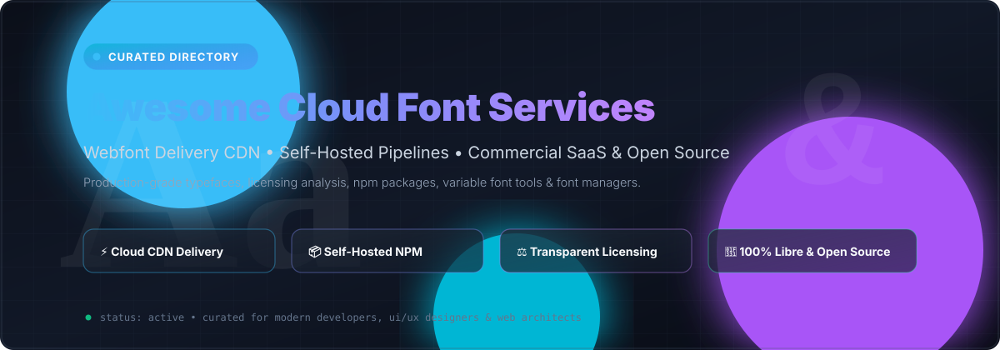

# 🌟 Awesome Cloud Font Subscription Service & Webfont Pipelines 🎨

  

  
  
  
  
  
  

---

## ⚡ Top Cloud Font Subscription Service Ecosystem & Typography Tools

> A comprehensive, SEO-optimized directory of **Cloud Font Subscription Services**, **Webfont CDNs**, **Self-Hosted Typography Frameworks**, and **Open-Source Font Engineering Pipelines**.

Whether you are an enterprise architect seeking compliant font licensing, a UI/UX designer choosing modern brand typography, or a frontend engineer optimizing web performance with self-hosted variable fonts, this curated guide benchmarks commercial SaaS and open-source alternatives.

---

## 📑 Table of Contents

- [📊 Sector Overview & Market Dynamics](#-sector-overview--market-dynamics)
- [🏢 SaaS & Hosted Commercial Platforms](#-saas--hosted-commercial-platforms)
- [🚀 Open-Source GitHub Projects](#-open-source-github-projects)
  - [Top Projects (Ranked by GitHub_Stars)](#top-projects-ranked-by-github-stars)
- [🤝 How to Contribute](#-how-to-contribute)
- [💖 Support & Sponsorship](#-support--sponsorship)
- [📈 Star History](#-star-history)
- [⚖️ Disclaimer](#️-disclaimer)

---

## 📊 Sector Overview & Market Dynamics

The global digital font and typography software market is estimated at approximately **$1.1B to $1.25B** (projected to reach **~$1.7B+** at a ~4.2% CAGR). The commercial typography landscape is moderately concentrated with oligopolistic, winner-take-most dynamics dominated by giant incumbents like **Monotype** (which consolidated Linotype, MyFonts, Fontsmith, and URW) and **Adobe** controlling vast proprietary type libraries. Concurrently, the web delivery and developer ecosystem is revolutionized by open-source distribution—anchored by **Google Fonts**, self-hosted npm packages via **Fontsource**, and modern variable font pipelines that bypass vendor lock-in.

---

## 🏢 SaaS & Hosted Commercial Platforms

| Product | Description | Company Scale (Revenue / Valuation) | Pricing | Free Tier Limit |
| :--- | :--- | :--- | :--- | :--- |
| **[Google Fonts](https://fonts.google.com/)** | 1,500+ open-source font families, free for any use including commercial, with high-performance global CDN delivery. | **Alphabet / Google**: ~$350B+ annual revenue, ~$2T+ market cap | **Free** ($0, completely open-source under OFL/Apache 2.0) | **Fully free**: 1,500+ font families completely free forever for personal & commercial use with no pageview limits. |
| **[Adobe Fonts](https://fonts.adobe.com/)** | 20,000+ font library included with Creative Cloud subscriptions, featuring seamless desktop sync and webfont hosting. | **Adobe Inc.**: ~$21B+ annual revenue, ~$150B–$220B market cap | Included with Creative Cloud subscriptions starting from **$22.99/month** (single app) or **$59.99/month** (all apps) | **Free tier available**: ~5,500 fonts free forever for non-commercial use within Creative Cloud apps; 7-day free trial for full Creative Cloud plans. |
| **[Creative Market](https://creativemarket.com/)** | Marketplace for independent font creators, digital type designers, and font bundles. | **Dribbble / Tiny**: Backed by Tiny; platform creators surpassed $165M+ in lifetime earnings | Pay-per-asset starting at **$12** (single weight), **$15** (font family desktop/web), and **$72** (app license) | No permanent free catalog; weekly drop of **4–6 free design goods/fonts** rotating every 7 days. |
| **[Monotype Fonts](https://www.monotype.com/)** | Enterprise cloud font subscription with 150,000+ fonts from 2,000+ foundries, team management, and digital rights tracking. | **Monotype Imaging (HGGC)**: ~$250M+ annual revenue; acquired for **$825M** valuation | **Web Kit Lite**: **$2,500/year**; **Web Kit 2.0**: **$7,500/year**; **Standard**: **$20,500/year** | **30-day free trial** with full library prototyping/mockup rights (no live commercial publishing). |
| **[MyFonts](https://www.myfonts.com/)** | Monotype-owned storefront for purchasing perpetual desktop, web, app, and e-pub licenses across thousands of independent foundries. | Subsidiary of **Monotype** (~$825M valuation) | Per-font licensing starting at **$20–$35** for display fonts and **$35–$70** for professional text styles | No perpetual free catalog; browser-based interactive **Test Drive** preview tool with occasional free promotional weights per foundry. |
| **[Linotype.com](https://www.linotype.com/)** | Monotype's classic foundry storefront offering world-renowned classics (*Helvetica, Frutiger, Univers*) under commercial licenses. | Subsidiary of **Monotype** (~$825M valuation) | Per-font licensing starting at **€35 (~$38)** for a single style / weight | No perpetual free tier; live in-browser **Test Drive** preview and prototyping trials via Monotype Fonts. |
| **[Type Network](https://typenetwork.com/)** | Curated foundry network featuring independent type designers, offering enterprise web licensing and news typography collections. | **Private / Boutique network** of leading independent foundries | **News Library**: from **$2,000/year**; **Metro (12 fonts)**: **$2,500/year** (up to 1M pageviews); **National (20 fonts)**: **$4,500/year** | **30-day free trial** for webfont integration testing; downloadable desktop trial packages upon account registration. |
| **[Fontstand](https://fontstand.com/)** | Rent-to-own font platform: rent fonts for 10% of retail price monthly; after 12 months, own them permanently. | **Private / Independent foundry co-op** (Fontstand BV) | **10% of font retail price/month** (e.g. ~$3.50/mo for a $35 font); **$4.99/month** for iPad full access | **1-hour free trial** per font style (up to 10 fonts/day) for local testing in design apps; app download is free forever. |

---

## 🚀 Open-Source GitHub Projects

The open-source typography ecosystem empowers teams to self-host fonts, automate font pipelines, and eliminate external CDN tracking. Repositories below are ordered by GitHub_Stars_Count in descending order.

### Top Projects (Ranked by GitHub_Stars)

- **[Fira Code](https://github.com/tonsky/FiraCode)**   
  *Free monospaced font with programming ligatures.* Designed specifically for code editors and technical terminals, supporting ASCII ligatures for multi-character sequences (`!=`, `===`, `=>`).

- **[Cascadia Code](https://github.com/microsoft/cascadia-code)**   
  *Modern, fun monospaced typeface from Microsoft.* Ships with coding ligatures, embedded powerline symbols, and full variable weight support. Standard for Windows Terminal and Visual Studio.

- **[Google Fonts](https://github.com/google/fonts)**   
  *The world's largest open-source font collection.* 1,500+ production font families under libre licenses (OFL, Apache 2.0). Contains raw source files, metadata, and subset definitions for web and local deployment.

- **[Source Code Pro](https://github.com/adobe-fonts/source-code-pro)**   
  *Adobe's monospaced open-source superfamily.* Designed specifically for user interface environments and programming applications with wide language support.

- **[Inter](https://github.com/rsms/inter)**   
  *The ubiquitous UI typeface for computer screens.* Features tall x-height, extensive OpenType features, optical sizing, and continuous variable font axes tailored for digital products and web interfaces.

- **[IBM Plex](https://github.com/IBM/plex)**   
  *IBM's corporate open-source superfamily.* Comprises Plex Sans, Plex Serif, Plex Mono, and language-specific scripts (Arabic, Devanagari, Hebrew, Thai, Japanese, etc.) for cross-platform international typography.

- **[FontForge](https://github.com/fontforge/fontforge)**   
  *Free and open-source font editor.* A full-featured desktop GUI and Python scripting environment for creating, editing, and converting outline and bitmap fonts (TrueType, OpenType, PostScript, SVG).

- **[Fontsource](https://github.com/fontsource/fontsource)**   
  *Self-hostable npm packages for open-source fonts.* Packages the entire Google Fonts library and more into zero-config npm modules for privacy-friendly, versioned, offline webfont bundling.

- **[HarfBuzz](https://github.com/harfbuzz/harfbuzz)**   
  *Industry-standard OpenType text shaping engine.* Powers text layout and complex script rendering across Chrome, Firefox, Android, LibreOffice, and Flutter.

- **[fonttools](https://github.com/fonttools/fonttools)**   
  *Premier Python library for manipulating font files.* Used worldwide for WOFF2 compression, font subsetting, TTX XML conversion, variable font compilation, and webfont build pipelines.

- **[Source Sans](https://github.com/adobe-fonts/source-sans)**   
  *Adobe's first open-source typeface family.* Clean sans-serif designed for UI readability across digital devices and desktop publishing.

- **[Font Bakery](https://github.com/googlefonts/fontbakery)**   
  *Quality assurance and linter tool for font binaries.* Used by Google Fonts and independent type designers to test font metadata, contours, OpenType tables, and cross-platform rendering issues.

- **[League Spartan](https://github.com/theleagueof/league-spartan)**   
  *High-impact geometric sans-serif typeface from The League of Moveable Type.* Open-source revival inspired by Spartan, featuring an expansive variable weight axis.

---

## 🤝 How to Contribute

Contributions, suggestions, and corrections are warmly welcome! 🛠️

1. 🍴 **Fork the repo**.
2. 🌿 **Create a feature branch** (`git checkout -b feature/add-new-font-service`).
3. 📝 **Add or update entries** in `README.md` following existing tabular/list formats.
4. ✅ **Ensure accuracy**: provide factual pricing, transparent free tier limits, and working links.
5. 🚀 **Submit a Pull Request** with a concise description of your additions.

---

## 💖 Support & Sponsorship

If you find this curated directory helpful for your webfont pipelines, design systems, or font compliance decisions, please consider supporting the project:

- ⭐ **Star this repository** to help others discover it!
- 🍴 **Fork and share** with fellow designers, developers, and typography enthusiasts.
- ☕ **Buy me a coffee / Sponsor**: Support ongoing maintenance and curation on the [GitHub Sponsors Dashboard](https://github.com/sponsors/ishandutta2007).

---

## 📈 Star History

---

## ⚖️ Disclaimer

- This repository is a **community-curated guide** intended for informational and educational purposes. Mention of commercial platforms does not constitute an endorsement.
- **Licensing Compliance Notice**: Always review the official End User License Agreement (EULA) of type foundries prior to deploying fonts in production websites, mobile apps, or advertising campaigns.
- Open-source font projects listed are governed by their respective licenses (SIL Open Font License 1.1, Apache 2.0, MIT, Ubuntu Font License).
